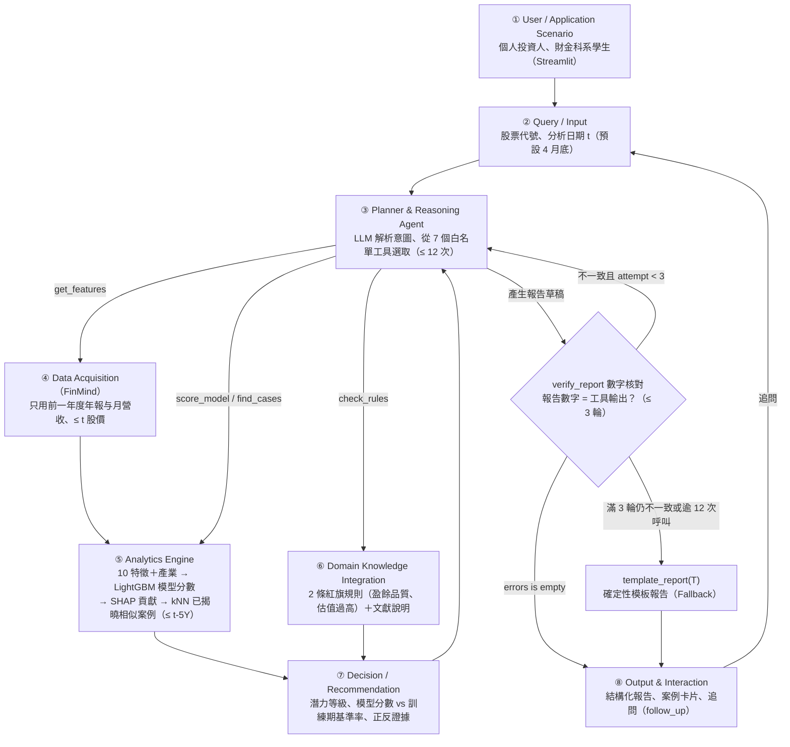

# Multibagger Scout System Specification (Converted from `DESIGN.md` v0.6)

本規格文件將 `DESIGN.md`（v0.6）之系統架構、Point-in-Time 資料工程、模型評估與 Agent 主流程（Algorithm 1 & 2）轉化為標準 **OpenSpec 規格與可驗證情境（Requirements & Scenarios）**。

---

## 1. System Architecture & Workflow Overview

---

## 2. Formal Requirements & Scenarios

### Requirement: Point-in-Time Universe & Data Acquisition (Module ④)
系統 SHALL 以每年 4 月最後一個交易日作為特徵日 $t$，只納入當時已在臺灣證券交易所（TWSE）上市滿一年之普通股（4 位數非 0 開頭代號，含後來下市之公司，排除 9 開頭存託憑證、ETF 與特別股），並排除特徵日前一年日均成交值最低 10% 及當時仍在興櫃交易之樣本。財報與月營收特徵 SHALL 只使用前一年度（12/31 年報與前一年 1–12 月營收合計）。

#### Scenario: 興櫃議價期間之判定與排除
- **WHEN** 某檔股票在特徵日 $t$ 前 90 天內有 5 天（含）以上的開高低收價格不在上市股票升降單位（Tick Size）上
- **THEN** 系統判定該「公司 × 年份」於特徵日 $t$ 仍在興櫃，不納入當年度研究母體，待其正式上市滿一年後之年份才納入。

#### Scenario: 防止前視偏誤之特徵時間限制
- **WHEN** 系統於第 $y$ 年 4 月底特徵日 $t$ 呼叫 `get_features` 計算 10 項特徵（市值、FCF 殖利率、帳面／市值、本益比、ROE、毛利率、年營收成長率、營業現金流／淨利、負債比、過去 12 個月含息報酬）＋產業類別
- **THEN** 系統只讀取第 $y-1$ 年度年報、第 $y-1$ 年 1–12 月營收與 $\le t$ 之交易日股價及減資／分割紀錄，絕不使用第 $y$ 年第 1 季季報或第 $y$ 年 1–3 月營收。

---

### Requirement: Wealth-Preserving Return & Dual-Label Construction (Algorithm 2)
系統 SHALL 以每日股價累乘除權息、減資（現金減資與彌補虧損減資）與股票分割／面額變更參考價因子，建立每日含息財富序列，並取觀察期終點（$t + 5\text{Y}$）最後 20 個交易日之含息財富平均計算 5 年含息報酬，據此建立對照標記 `y_raw`、主要標記 `y_main` 與 `UNKNOWN` 狀態。

#### Scenario: 主要標記 `y_main` 與對照標記 `y_raw` 賦值
- **WHEN** 某檔合格樣本之 5 年含息報酬無單日超過漲跌幅限制（2015-06 前 7%、之後 10%）之價格異常，且排名當年度可排名母體 $N$ 檔之前 $\lceil 0.05 N \rceil$ 檔
- **THEN** 其對照標記設為 `y_raw = 1`；若其第 $y-1$ 年至第 $y+4$ 年之 5 年營收年複合成長率（CAGR）可判定且 $\ge 10\%$，則主要標記設為 `y_main = 1`，若營收 CAGR $< 10\%$ 則 `y_main = 0`，若期間下市未滿 5 年或營收缺漏／跨 2012–2013 IFRS 口徑跳升逾 3 倍，則 `y_main = UNKNOWN`。

#### Scenario: `UNKNOWN` 標記不當成負例
- **WHEN** 某筆樣本因價格異常、期間併購／重整下市未滿 5 年或營收缺漏而被標記為 `UNKNOWN`
- **THEN** 系統在訓練與主結果評估中將其排除，絕不強行視為負例（`0`），並在各輪實驗報告中公開揭露 `UNKNOWN` 筆數與原因。

---

### Requirement: Non-Overlapping Walk-Forward Training & Case Retrieval (Module ⑤)
系統 SHALL 以 2013–2020 年 8 個視窗執行三輪 walk-forward 驗證（測試年分別為 2018、2019、2020），且訓練集與 kNN 歷史案例庫 SHALL 只使用標記所有必要輸入在決策日 $t$ 之前已完全揭曉（即特徵日 $\le t - 5\text{Y}$）之樣本。

#### Scenario: 訓練視窗與測試視窗零洩漏隔離
- **WHEN** 系統訓練第 $k$ 輪模型（例如第 1 輪測試 2018-04）或檢索 kNN 相似案例
- **THEN** 只允許使用特徵年觀察期於測試起點前已結束之樣本（第 1 輪僅用 2013 年特徵、其 5 年觀察期於 2018-04 結束；第 2 輪用 2013–2014；第 3 輪用 2013–2015），所有缺值填補、縮放與領域規則門檻均只用當輪訓練集擬合。

---

### Requirement: PoT Whitelisted Tool Execution & 3-Round Numerical Verification (Algorithm 1, Modules ③⑥⑦⑧)
Agent SHALL 只從 7 個白名單工具（`analyze_stock`、`get_features`、`score_model`、`find_cases`、`check_rules`、`follow_up`、`verify_report`）中選擇工具執行（每次請求最多 12 次工具呼叫），不讓 LLM 計算任何數字，且未完成機率校準前一律稱 `predict_proba` 輸出為「模型分數」。生成報告時 SHALL 經過最多 3 輪 `verify_report` 自動數字核對。

#### Scenario: 報告數字核對通過與自動重寫迴圈
- **WHEN** LLM 依工具證據包 $T$ 生成結構化報告草稿 $R$
- **THEN** `verify_report(R, T)` 自動核對報告中之公司、期間、單位、數值與 `evidence_id` 來源；若完全一致（`errors is empty`）則輸出 $R$；若有不一致則將差異加入修正上下文重寫（最多 3 輪）；若滿 3 輪仍有誤差或工具呼叫逾 12 次，則強制回傳確定性模板報告 `template_report(T)`。

